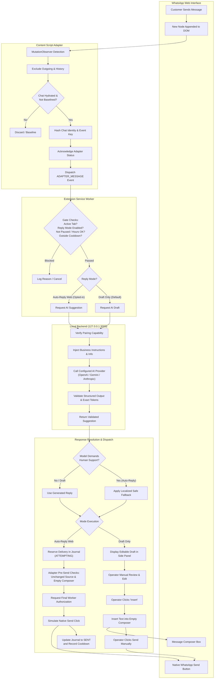
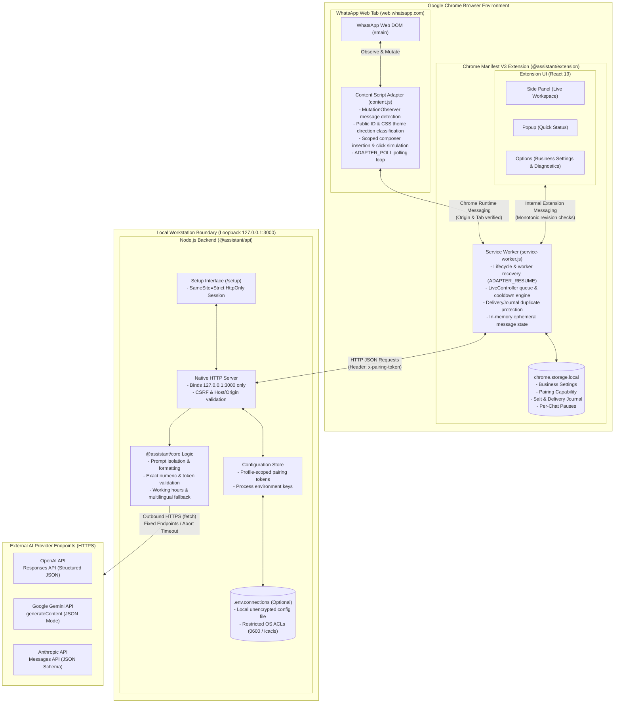

<div align="center">

<h1 align="center">WhatsApp Business Assistant</h1>

<p align="center">
  <strong>A privacy-focused, locally hosted AI assistant for WhatsApp Web customer operations</strong>
</p>

<p align="center">
  <a href="https://github.com/prajx-max/whatsapp-business-assistant"></a>
  <a href="https://github.com/prajx-max/whatsapp-business-assistant"></a>
  <a href="https://github.com/prajx-max/whatsapp-business-assistant"></a>
  <a href="https://nodejs.org/">= 24" /></a>
  <a href="https://pnpm.io/">= 11" /></a>
  <a href="https://www.typescriptlang.org/"></a>
  <a href="https://react.dev/"></a>
  <a href="https://vite.dev/"></a>
  
  
</p>

<p align="center">
  <a href="#overview">Overview</a> •
  <a href="#key-features">Key Features</a> •
  <a href="#application-workflow">Workflow</a> •
  <a href="#architecture">Architecture</a> •
  <a href="#technology-stack">Tech Stack</a> •
  <a href="#installation-and-setup">Installation</a> •
  <a href="#configuration-guide">Configuration</a> •
  <a href="#privacy-and-security">Privacy & Security</a> •
  <a href="#testing">Testing</a> •
  <a href="#current-limitations">Limitations</a> •
  <a href="#roadmap">Roadmap</a>
</p>

---

</div>

> [!NOTE]
> **Interface Preview Placeholder**: An annotated preview of the WhatsApp Web side panel interface can be linked here (`docs/assets/workspace-preview.png`). Visual assets can be stored in the `docs/assets/` directory.

---

## Overview

**WhatsApp Business Assistant** is an open-source, privacy-preserving developer tool that integrates conversational AI directly into WhatsApp Web. Operating as a hybrid system—a Chrome Manifest V3 browser extension coupled with a local Node.js loopback backend—it assists business operators in responding to customer inquiries quickly, consistently, and accurately.

### The Problem It Solves

Customer communication on WhatsApp Web often faces significant operational hurdles:

- **Operator Fatigue**: High volumes of repetitive questions regarding pricing, business hours, stock availability, and service policies lead to delayed response times and burnout.
- **Inconsistent Answers**: Without a centralized reference, operators provide conflicting information across shifts.
- **Privacy & Security Risks**: Cloud-hosted third-party automation tools frequently require granting remote servers unrestricted access to chat histories, customer phone numbers, and private API keys.

### The Solution

WhatsApp Business Assistant keeps the entire operational boundary local to the operator's machine:

- **Zero Cloud Intermediaries**: The local API backend runs on `127.0.0.1:3000`. Provider API keys remain strictly on the backend and are never exposed to browser storage or client-side scripts.
- **Human-in-the-Loop by Default**: The default **Draft Only** mode prepares contextually grounded responses for operator review and editing. The operator decides what gets sent.
- **Guarded Automation**: An explicitly opted-in **Auto-reply** mode allows hands-free responses to fresh incoming messages in the active chat, protected by strict verification gates (working hours, per-chat cooldowns, active-tab focus, and duplicate delivery journals).

### Who It Is Designed For

- **Small-to-Medium Businesses (SMBs)** managing sales, order inquiries, and customer care on WhatsApp Web.
- **Customer Support Agents** seeking instant, fact-checked draft suggestions grounded in authoritative business guidelines.
- **Privacy-Conscious Teams** requiring AI assistance without transferring customer conversation databases to external SaaS aggregators.

---

## Key Features

### 1. AI-Powered Reply Generation

- **Context-Aware Suggestions**: Analyzes newly received incoming messages in the active chat and synthesizes responses based on operator-defined business instructions and facts.
- **Multi-Provider Support**: Seamlessly connects to **OpenAI** (Responses API with structured JSON), **Google Gemini** (`generateContent` with JSON mode), or **Anthropic** (Messages API with JSON schema).
- **Factual Grounding Checks**: Validates model output against exact numeric tokens, currency values, and URLs defined in operator data. If unconfirmed facts are requested, the assistant transitions to a safe fallback draft.

### 2. Draft Only Mode (Safe Default)

- Generates an editable draft inside the Chrome extension Side Panel workspace.
- The operator reviews and customizes the draft text.
- Clicking **Insert** writes the text directly into the WhatsApp Web message composer.
- **The operator retains complete control**: the extension never triggers the native send button in Draft Only mode.

### 3. Opt-in Auto-Reply Mode (`AUTO_REPLY_WEB`)

- **Explicit Operator Opt-In**: Disabled by default. Enabling requires selecting `AUTO_REPLY_WEB` in settings and checking an explicit acknowledgement consent box.
- **Unattended Active-Chat Sending**: Automatically populates the composer and triggers the native WhatsApp send button for eligible incoming messages in the currently active chat.
- **Multi-Layer Pre-Send Verification**:
  1. Validates that the active browser tab is the verified WhatsApp Web tab.
  2. Ensures the incoming source message is fresh (within the configured duplicate window, capped at 300 seconds).
  3. Confirms the message composer was initially empty and matches the exact generated text.
  4. Requires final cryptographic authorization from the background service worker immediately before clicking.

### 4. Business Profile & Instructions

- **Custom Guidelines**: Up to 8,000 characters of natural-language reply instructions to guide tone, style, greetings, and escalation protocols.
- **Authoritative Business Facts**: Up to 16,000 characters of verified business details (products, pricing, policies, addresses, hours).
- **Tone & Language Controls**: Select between `friendly`, `professional`, `formal`, or `casual` tones. Configured for multiple languages (English, Kannada, Telugu, Tamil, Hindi) with automatic language detection.
- **Working Hours Schedules**: Enforces opening and closing schedules per day of the week, with configurable outside-hours behavior (`NO_REPLY` or `DRAFT`).

### 5. Local Provider Configuration

- **Local Web Interface**: Hosted at `http://127.0.0.1:3000/setup` for secure model selection, API key entry, and extension pairing.
- **Credential Protection**: Keys are loaded directly into backend process memory. The browser extension only receives a random, profile-scoped pairing capability token.
- **Restart-Stable Connections (v0.3.4)**: The optional "Remember connection on this PC" feature saves configuration to an unencrypted, Git-ignored local file (`.env.connections`) with restricted operating system permissions (POSIX `0600` / Windows `icacls`), preserving pairing across backend restarts.

### 6. Per-Chat Pause & Resume

- Operators can pause automated handling for individual customer conversations directly from the Side Panel workspace.
- Pauses are tracked using business-scoped SHA-256 chat hashes and persist across background service worker restarts without affecting other customer chats.

### 7. Cooldown & Queue Management

- **In-Memory Request Serialization**: Prevents race conditions by processing incoming messages through a serialized async queue.
- **Per-Chat Cooldown**: Configurable minimum delay (`perChatCooldownSeconds`) between automatic responses to the same contact.
- **Lightweight Polling Bridge**: The content script issues periodic `ADAPTER_POLL` pulses (1-second intervals) to allow queued cooldowns to advance without keeping background workers artificially awake.

### 8. Background Worker Recovery

- **Chrome MV3 Lifecycle Resilient**: Fully accommodates Chrome's idle service worker terminations. Upon wakeup, an `ADAPTER_RESUME` event re-synchronizes state without rebaselining the chat or replaying historical messages.
- **Public Tail-ID Anchoring**: Remounted sent rows preserve container continuity so new incoming messages are never swallowed during DOM re-renders.
- **Scripting API Bridge Restoration**: Reconnects orphaned or missing content adapters in existing WhatsApp tabs using the Chrome Scripting API without requiring a webpage reload.

### 9. Privacy & Security Controls

- **Loopback-Only Binding**: Local API binds exclusively to `127.0.0.1`. Requests are validated with strict Host, Origin, and CSRF token checks.
- **No Chat History Logging**: Raw incoming messages and generated AI replies remain in volatile memory and are discarded when the browser or extension restarts.
- **Salted Hash Identifiers**: Chat keys and delivery tracking entries are hashed with a local per-installation UUID salt and scoped by business profile ID.

---

## Application Workflow

The flowchart below illustrates how an incoming customer message travels through the content adapter, service worker verification gates, local AI backend, and dispatch resolution:



---

## Architecture

The project is structured as a modular TypeScript monorepo using pnpm workspaces. The architecture strictly decouples DOM interaction, background coordination, business rules, and external AI connectivity:



### Component Breakdown & Boundaries

| Component | Package / Path | Role & Operational Boundary |
| :--- | :--- | :--- |
| **Content Script Adapter** | `apps/extension/src/content/` | Thin DOM observer injected into WhatsApp Web. Detects incoming messages, extracts display text, classifies direction via public data IDs and bubble background themes, inserts approved drafts, and executes native click actions when authorized. |
| **Service Worker** | `apps/extension/src/background/` | Central coordinator. Manages active tab state, evaluates working hours and duplicate windows, sequences in-memory queues, persists the `DeliveryJournal`, handles worker recovery (`ADAPTER_RESUME`), and communicates with the backend. |
| **Extension UI** | `apps/extension/src/{sidepanel,options,popup}/` | React 19 interface providing the live reply workspace (side panel), quick status view (popup), and business profile settings with DOM diagnostics (options). |
| **Local API Server** | `apps/api/src/` | Lightweight Node.js service binding strictly to `127.0.0.1:3000`. Manages the `/setup` web interface, validates profile pairing tokens, loads LLM keys into process memory, and executes outbound HTTPS requests to AI providers. |
| **Core Assistant Rules** | `packages/core/src/` | Pure business logic: prompt assembly with untrusted customer text separation, exact numeric/token grounding checks, language detection, and localized safe fallbacks. Contains zero DOM or browser dependencies. |
| **Contracts & Schemas** | `packages/contracts/src/` | Shared Zod schemas and inferred TypeScript types defining all API payloads, extension events, entity definitions, and runtime validation rules. |

---

## Technology Stack

The project relies on a modern, strictly typed TypeScript toolchain without unnecessary heavyweight frameworks:

| Layer | Technology | Version | Purpose |
| :--- | :--- | :--- | :--- |
| **Language** | [TypeScript](https://www.typescriptlang.org/) | `6.0.3` | End-to-end strict type safety across packages and applications |
| **Runtime** | [Node.js](https://nodejs.org/) | `>=24.0.0 <25` (Pinned `24.22.1`) | Native HTTP server, environment management, and ESM execution |
| **Package Manager** | [pnpm](https://pnpm.io/) | `>=11.25.0 <12` (Pinned `11.25.0`) | Monorepo dependency management and local package isolation |
| **Browser Extension** | Chrome Extensions MV3 | Manifest V3 | Browser integration via `storage`, `sidePanel`, and `scripting` |
| **Frontend UI** | [React](https://react.dev/) | `19.3.1` | Declarative UI for Side Panel, Popup, and Options interfaces |
| **Build Tooling** | [Vite](https://vite.dev/) | `8.3.5` | High-performance bundling for extension pages and content scripts |
| **Validation** | [Zod](https://zod.dev/) | `4.6.7` | Runtime contract enforcement, event schemas, and input validation |
| **Unit Testing** | [Vitest](https://vitest.dev/) | `5.0.5` | Fast unit and integration testing across core logic and backend |
| **DOM Testing** | [Testing Library](https://testing-library.com/) / [jsdom](https://github.com/jsdom/jsdom) | `16.3.3` / `30.1.3` | React component testing and browser environment simulation |
| **E2E Testing** | [Playwright](https://playwright.dev/) | `1.64.1` | Headless/headed Chromium browser automation for unpacked extensions |
| **Code Quality** | [ESLint](https://eslint.org/) / [Prettier](https://prettier.io/) | `10.13.0` / `3.9.10` | Static code analysis, security linting, and automated formatting |

---

## Project Structure

```text
whatsapp-business-assistant/
├── .github/                       # GitHub Actions workflows and CI configurations
├── apps/
│   ├── api/                       # Local AI backend server
│   │   ├── setup/                 # Local setup interface source (setup.ts, tsconfig.json)
│   │   ├── src/                   # Server entrypoint, configuration store, LLM providers
│   │   ├── tests/                 # Backend HTTP, CSRF, and restart integration tests
│   │   └── package.json
│   └── extension/                 # Chrome Manifest V3 browser extension
│       ├── public/                # Static assets, icons, and HTML entry points
│       ├── src/
│       │   ├── background/        # Service worker, live controller, delivery journal
│       │   ├── content/           # WhatsApp Web DOM observer & composer insertion
│       │   ├── diagnostics/       # DOM structural report & selector introspection
│       │   ├── options/           # Business profile settings & instruction editor
│       │   ├── sidepanel/         # Live workspace, draft editor, chat pause/resume
│       │   └── storage/           # Chrome storage repository & monotonic revisions
│       ├── tests/                 # Adapter, composer, direction, and live controller tests
│       ├── manifest.config.ts     # Extension Manifest V3 configuration (v0.3.4)
│       ├── vite.config.ts         # Vite build configuration for extension UI
│       └── package.json
├── packages/
│   ├── contracts/                 # Shared Zod schemas and TypeScript interfaces
│   ├── core/                      # Pure business rules, prompt builder, grounding guards
│   ├── knowledge/                 # Knowledge normalization and retrieval contracts
│   ├── test-fixtures/             # Synthetic DOM fixtures and mock business records
│   └── ui/                        # Shared UI primitives
├── docs/                          # Architecture, security reviews, and release reports
├── e2e/                           # Playwright end-to-end browser test workflows
├── scripts/                       # Build artifact verification scripts
├── .env.example                   # Example local backend environment variables
├── package.json                   # Root workspace package manifest
├── pnpm-workspace.yaml            # pnpm workspace package definitions
├── playwright.config.ts           # Playwright E2E configuration
├── vitest.config.ts               # Vitest root test runner configuration
└── README.md                      # Project documentation
```

<details>
<summary><strong>Workspace Package Responsibilities</strong></summary>

| Package | Purpose & Boundary Constraints |
| :--- | :--- |
| `@assistant/contracts` | Canonical Zod validation schemas, TypeScript contracts, and event definitions. Depends only on Zod. |
| `@assistant/core` | Pure deterministic business logic: prompt building, grounding validation, multilingual safe fallbacks, and working hours calculation. Zero browser or transport dependencies. |
| `@assistant/knowledge` | Knowledge base interfaces, schema mappings, and retrieval cache contracts. |
| `@assistant/ui` | Shared UI component primitives and design tokens used across extension views. |
| `@assistant/test-fixtures` | Synthetic WhatsApp DOM trees, mock business profiles, and deterministic test fixtures. |
| `@assistant/api` | Native Node.js HTTP server (port 3000) managing `/setup`, credential loading into process memory, and outbound LLM fetch requests. |
| `@assistant/extension` | Chrome Manifest V3 extension containing the DOM content adapter, service worker controller, React 19 UI, and persistent delivery journal. |

</details>

---

## Installation and Setup

### Prerequisites

Before setting up the project, ensure your environment meets the following requirements:

- **Node.js**: `24.x` (repository pins `24.22.1`).
- **pnpm**: `11.x` (repository pins `11.25.0`).
- **Google Chrome**: Version `116` or higher (required for Chrome Side Panel API).
- **AI Provider Account**: An active API key from **OpenAI**, **Google Gemini**, or **Anthropic**.

---

### Step 1: Clone the Repository

```bash
git clone https://github.com/prajx-max/whatsapp-business-assistant.git
cd whatsapp-business-assistant
```

### Step 2: Install Dependencies

Install all workspace dependencies using the frozen lockfile:

```bash
pnpm install --frozen-lockfile
```

### Step 3: Configure Backend Environment

Copy the example environment template to create your local `.env` file:

**Windows PowerShell:**

```powershell
Copy-Item .env.example .env
```

**macOS / Linux:**

```bash
cp .env.example .env
```

> [!TIP]
> While you can specify default first-use environment variables in `.env`, the **recommended flow** is to configure your provider, model, and API key interactively using the local setup interface described in [Step 5](#step-5-start-the-local-backend).

### Step 4: Build the Chrome Extension

Compile the Chrome Manifest V3 extension:

```bash
pnpm --filter @assistant/extension build
```

The production extension bundle will be generated in `apps/extension/dist`.

### Step 5: Start the Local Backend

Start the local API backend:

```bash
pnpm dev:api
```

The local server will start on `http://127.0.0.1:3000`. Keep this terminal window running.

### Step 6: Load the Extension in Google Chrome

1. Open Google Chrome and navigate to `chrome://extensions/`.
2. Enable the **Developer mode** toggle in the top-right corner.
3. Click the **Load unpacked** button in the top-left toolbar.
4. Select the `apps/extension/dist` directory from this repository.
5. Confirm that **Universal Business Assistant** (version `0.3.4`) appears in your extension list.

---

## Configuration Guide

### 1. AI Provider Setup & Pairing

1. With the backend running, open the local setup interface in your browser:

   ```text
   http://127.0.0.1:3000/setup
   ```

2. Enter your **Business Profile ID** (defaults to `sweet-crumbs-demo` or your custom business identifier).
3. Select your **AI Provider** (`openai`, `gemini`, or `anthropic`).
4. Enter your chosen **Model ID** (e.g., `gpt-4o`, `gemini-1.5-flash`, or `claude-3-5-sonnet-20241022`).
5. Enter your **API Key**.
6. *(Recommended)* Check **Remember connection on this PC** if you want your configuration to survive backend restarts.
7. Click **Save Configuration**.
8. Once saved, copy the generated **Pairing Code**.

### 2. Configure Business Settings in Extension

1. In Google Chrome, click the extension icon and select **Settings** (or right-click the extension icon and choose **Options**).
2. Under the **Backend Connection** section:
   - Ensure the Backend URL is `http://127.0.0.1:3000`.
   - Paste your **Pairing Code** into the pairing field.
   - Click **Pair Backend**.
3. Under **Business Information & Instructions**:
   - Fill in your business name, industry, support phone numbers, and operational timezone.
   - Enter your **Business Information** (factual catalogue, pricing, delivery policies).
   - Enter your **Reply Instructions** (desired conversation tone, mandatory disclaimers, escalation rules).
4. Save your business settings.

### 3. Set Reply Preferences

```text
Extension Settings > Reply Preferences
```

| Setting | Default | Description |
| :--- | :--- | :--- |
| **Reply Mode** | `Draft Only` | Choose between `Draft Only`, `Auto-reply`, or `Off`. |
| **Allow automatic sending without review** | `Disabled` (Unchecked) | **Mandatory consent checkbox** required before `Auto-reply` can be activated. |
| **Working Hours** | Mon–Sun schedules | Define opening and closing hours. Configure outside-hours action (`NO_REPLY` or `DRAFT`). |
| **Minimum time between replies** | `10 seconds` | Per-chat cooldown period preventing rapid successive automated replies to the same contact. |
| **Duplicate window** | `30 seconds` | Time window within which identical message events are deduplicated and ignored. |

### Draft Only vs. Auto-Reply Comparison

| Operational Aspect | Draft Only (Default) | Auto-Reply (`AUTO_REPLY_WEB`) |
| :--- | :--- | :--- |
| **Operator Consent** | Default setting; no extra consent needed | Requires explicit checkbox acknowledgement |
| **Response Generation** | Automatic upon new incoming message | Automatic upon new incoming message |
| **Review Gate** | **Mandatory human review** in Side Panel | **Unattended**; bypasses human review for eligible messages |
| **Composer Action** | Operator clicks "Insert" | Automatically populated if composer was empty |
| **Send Trigger** | **Manual**: Operator clicks native WhatsApp send | **Automated**: Extension simulates click on native send |
| **Human Handoff Behavior** | Leaves draft marked for review | Sends localized safe fallback message |
| **Recommended Use Case** | Daily customer care, custom quotes, complex queries | Standard FAQs, off-peak coverage, straightforward inquiries |

<details>
<summary><strong>Advanced Configuration: Persistent Connections (.env.connections)</strong></summary>

When checking **Remember connection on this PC** in the `/setup` interface:
- **Format**: Stored at the repository root as `.env.connections` (Git-ignored) containing a versioned, base64url-encoded JSON array of saved connections.
- **Payload**: Contains only `{ profileId, provider, model, apiKey, token }`. Never stores customer messages, chat text, or model replies.
- **Filesystem Permissions**: Automatically secured on creation:
  - **POSIX (Linux/macOS)**: Mode `0600` (read/write by file owner only).
  - **Windows**: Restricted using native `icacls.exe` to grant access exclusively to the current user and `SYSTEM`.
- **Precedence**: Once `.env.connections` exists, its entries are authoritative over first-use `.env` fallback values.
- **Revocation**: Unchecking "Remember" or clicking "Clear" immediately purges the credential from disk and invalidates the pairing capability.

</details>

---

## Privacy and Security

Security and privacy boundaries are foundational to the project's architecture:

```text
┌────────────────────────────────────────────────────────────────────────┐
│                        WORKSTATION BOUNDARY                            │
│                                                                        │
│  Chrome Browser (web.whatsapp.com)                                     │
│  ┌───────────────────────┐         Local Loopback (127.0.0.1:3000)     │
│  │  Content Script       │         ┌────────────────────────────────┐  │
│  │  (Zero API Keys)      │         │  Local Node.js API             │  │
│  └───────────┬───────────┘         │  (Holds API Key in Process     │  │
│              │ Runtime Msg         │   Memory or .env.connections)  │  │
│  ┌───────────▼───────────┐  HTTP   │                                │  │
│  │  Extension Worker     ├─────────►  Validates CSRF, Origin, &     │  │
│  │  (Pairing Code Only)  │         │  Profile Pairing Token         │  │
│  └───────────────────────┘         └────────────────┬───────────────┘  │
│                                                     │                  │
└─────────────────────────────────────────────────────┼──────────────────┘
                                                      │ HTTPS Outbound
                                                      ▼
                                       ┌─────────────────────────────┐
                                       │ Configured AI Provider      │
                                       │ (OpenAI / Gemini / Claude)  │
                                       └─────────────────────────────┘
```

- **Loopback-Only Isolation**: The local API binds strictly to `127.0.0.1`. It does not accept remote network connections. All incoming HTTP requests require a valid session CSRF token, same-origin headers, and profile-scoped pairing authorization.
- **API Key Containment**: API keys are submitted directly to the loopback backend via `/setup`. The key is stored in backend process memory (`process.env`) and is **never transmitted to the browser extension**.
- **Local Credential Persistence Notice**: When "Remember connection on this PC" is selected, credentials and pairing codes are written to `.env.connections` at the repository root. This file is **an unencrypted local configuration file** formatted as base64url-encoded JSON. It relies on operating system filesystem permissions (POSIX `0600` on Linux/macOS; restricted `icacls` current-user ACLs on Windows). It is **not** an encrypted vault and must never be committed to Git or shared.
- **In-Memory Message Ephemerality**: Customer message text, prompt assemblies, and model reply suggestions are kept exclusively in volatile memory. They are discarded whenever the service worker terminates or the browser closes. No customer conversation history is written to disk or logged.
- **Hashed Identifiers**: Chat keys and delivery records are stored using one-way SHA-256 hashes combined with an installation-unique salt (`assistant.hashSalt.v1`) and the business profile ID.
- **Delivery Journal Safeguards**: The `DeliveryJournal` stores at most 512 bounded deduplication records in `chrome.storage.local`. If storage is corrupted or limits are reached, the system fails closed rather than risking an accidental duplicate message send.

---

## Testing

The codebase maintains an extensive test suite verifying contract integrity, adapter resilience, backend security, and end-to-end browser flows.

### Available Test Commands

| Command | Description | Test Scope |
| :--- | :--- | :--- |
| `pnpm test` | Runs Vitest unit & integration test suites | Contracts, core rules, settings, adapter, delivery journal, and backend |
| `pnpm test:e2e` | Runs Playwright end-to-end browser tests | Real unpacked Chrome extension in automated Chromium instance |
| `pnpm check` | **Complete verification suite** | Runs `format:check`, `lint`, `typecheck`, `test`, `build`, and `test:e2e` |
| `pnpm lint` | Runs ESLint | Enforces strict TypeScript rules and code style across all packages |
| `pnpm typecheck` | Runs TypeScript project compiler (`tsc`) | Verifies strict types across production, tests, and build tooling |
| `pnpm format` | Runs Prettier write | Formats all project files automatically |
| `pnpm format:check` | Runs Prettier check | Verifies consistent codebase formatting |

### Test Suite Structure

<details open>
<summary><strong>Test Suite Breakdown (271 tests across 14 files + 2 E2E workflows)</strong></summary>

```text
Test Suite (271 tests across 14 files + 2 E2E workflows)
├── packages/contracts/tests/contracts.test.ts     # Zod schema boundaries and validation rules
├── packages/core/tests/grounding.test.ts           # 60 multilingual cases, prompt injection, fact checks
├── apps/api/tests/
│   ├── backend.test.ts                            # Loopback HTTP routes, CSRF, pairing auth, error redaction
│   └── restart.test.ts                            # Credential persistence (.env.connections) & restart stability
├── apps/extension/tests/
│   ├── adapter.test.ts                            # MutationObserver, baselines, selector fallbacks
│   ├── composer.test.ts                           # Scoped text insertion, display normalization
│   ├── delivery-journal.test.ts                   # ATTEMPTING reservations, cooldown expiration, bounds
│   ├── direction.test.ts                          # Public data-id & CSS bubble theme direction detection
│   ├── live-controller.test.ts                    # Queue serialization, consent enforcement, worker gates
│   ├── pending-poll.test.ts                       # ADAPTER_POLL pulses and cooldown continuation
│   ├── reconnect.test.ts                          # Scripting API injection and bridge recovery
│   ├── storage-router.test.ts                     # Monotonic settings revisions and trusted routing
│   ├── structure.test.ts                          # DOM structural diagnostic inspection reports
│   └── ui.test.tsx                                # React 19 UI component rendering and interactions
└── e2e/
    ├── extension.spec.ts                          # Shell settings persistence and UI mounting
    └── live-workflow.spec.ts                      # Full receive -> generate -> insert -> send automated workflow
```

</details>

> [!IMPORTANT]
> **Synthetic Testing vs. Real-Account Compatibility**:
> Automated unit, integration, and Playwright tests execute against **synthetic WhatsApp Web DOM fixtures** and **injected mock AI providers**. They verify that the internal state machines, selector logic, security gates, and worker recovery mechanisms function deterministically.
>
> **Automated tests do not prove compatibility with live WhatsApp Web accounts.** Meta frequently alters WhatsApp Web's internal DOM structure, CSS class names, and container hierarchies. Always verify extension behavior manually using a test chat before relying on it for business operations.

---

## Current Limitations

To maintain architectural transparency, the following technical limitations are explicitly documented:

- **WhatsApp Web DOM Dependency**: The content adapter relies on observing specific DOM elements and CSS variables. While selector pack migrations and fallback algorithms (v1 through v4) handle minor variations, significant structural updates by WhatsApp Web can disrupt message detection or composer insertion until updated selectors are released.
- **Active Chat Boundary**: The extension operates exclusively within the **currently selected, visible chat** in WhatsApp Web. It cannot monitor background chats, read inactive threads, or perform automated bulk messaging across multiple contacts.
- **Knowledge Input Scope**: Business information is currently supplied via an operator-entered text field (up to 16,000 characters). Full retrieval-augmented generation (RAG) with vector indexing is not yet implemented.
- **Unfinished Roadmap Stubs**: Contract definitions for `CreateTicketRequest` and team notifications represent interface stubs; external ticketing and notification integrations are not yet wired to active transport handlers.
- **Single Workstation Design**: Designed as a single-operator local tool. Does not support multi-tenant user authentication, cloud-synced databases, or remote webhooks.
- **Unencrypted Local Credentials**: The `.env.connections` file used for persistent backend pairing relies on local OS file access controls, not cryptographic encryption at rest.

---

## Roadmap

The planned engineering roadmap includes the following milestones:

- [ ] **Google Sheets Knowledge Integration**: Automated two-way synchronization of product catalogues, FAQ spreadsheets, and pricing tables via Google Sheets API.
- [ ] **Vector Knowledge Retrieval (RAG)**: Integration of lightweight local embeddings to dynamically retrieve relevant paragraphs from large business documentation sets.
- [ ] **External Ticket Management**: Direct integration with customer support ticketing systems (Zendesk, Jira, Linear, or Freshdesk) when human handoffs occur.
- [ ] **Multi-Channel Team Notifications**: Automated alerting via Slack, Discord, or email webhooks when customer conversations require urgent operator intervention.
- [ ] **Persistent Follow-up Alarms**: Chrome Alarms API integration for scheduled customer follow-ups that survive browser and computer reboots.
- [ ] **Official WhatsApp Business Platform Transport**: Headless backend transport option utilizing Meta's Cloud API for server-side, enterprise-scale message handling.

---

## Contributing

Contributions, bug reports, and suggestions are welcome! To contribute:

1. **Fork the Repository**: Create your own branch from `main`.
2. **Create a Feature Branch**:

   ```bash
   git checkout -b feature/your-feature-name
   ```

3. **Make Focused Changes**: Maintain documentation integrity, preserve docstrings, and write unit tests for new logic.
4. **Run the Complete Verification Suite**:

   ```bash
   pnpm check
   ```

   *All checks (formatting, linting, type checks, unit tests, builds, and E2E tests) must pass.*
5. **Submit a Pull Request**: Provide a detailed description of your changes, referencing relevant issue tickets.

Please review the documentation in the `docs/` directory before proposing major architectural modifications.

---

## License

No license has currently been specified for this repository. All rights are reserved by default unless an explicit open-source license is added by the repository owner.

---

<div align="center">

<p><strong>WhatsApp Business Assistant</strong> • Engineered for smart, safe, and privacy-respecting customer operations.</p>
<p><sub>Built to make business conversations smarter, faster, and more manageable.</sub></p>

</div>
